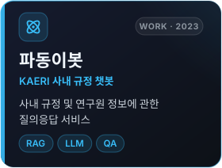
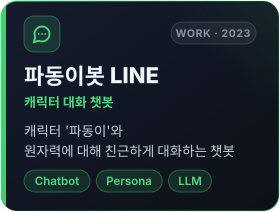
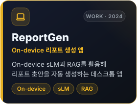
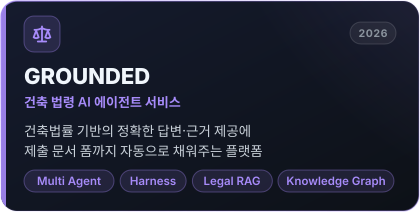
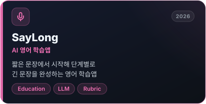
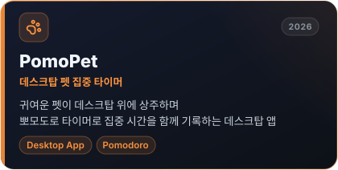
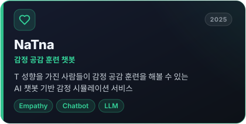

  

  

  사람의 <b>감정과 생산성</b>을 동시에 챙기는 <b>“AI 파트너”</b>를 만드는 엔지니어입니다. 
  사용자의 하루를 더 가볍고 생산적으로 만들어 주는 <b>실질적인 AI 동료</b>를 만듭니다.

 

## 🔥 Work Projects

  
  
  

## 💡 Personal Products

  
  
  
  

<!-- 카드 수정·추가: scripts/build_cards.py 의 CARDS 를 고친 뒤 `python3 scripts/build_cards.py` 실행 -->
